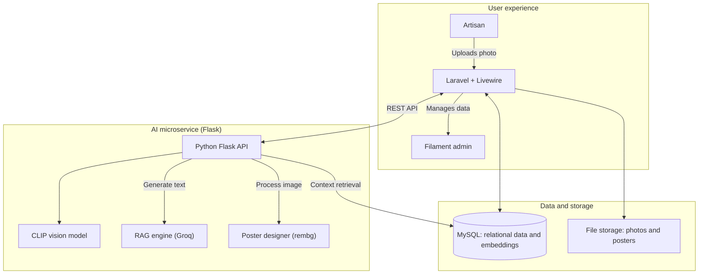

<div align="center">

# CARITA

**Cultural AI for Retail & Identity-Telling Assistant**

CARITA helps local artisans, starting with those in Majalengka, raise the value of their products<br>
through authentic cultural storytelling. It recognizes batik and woven motifs from a photo,<br>
writes a marketing narrative grounded in curated cultural research,<br>
and produces a ready-to-post digital poster.

<br>


[Features](#features) · [Architecture](#architecture) · [Getting started](#getting-started) · [How it works](#how-it-works) · [License](#license)

</div>

---

## Table of contents

- [Features](#features)
- [Architecture](#architecture)
- [Tech stack](#tech-stack)
- [Getting started](#getting-started)
- [How it works](#how-it-works)
- [Project structure](#project-structure)
- [Team](#team)
- [License](#license)

## Features

### AI capabilities

- **Vision recognition (CLIP).** Identifies batik and woven motifs from an uploaded photo using zero-shot classification, including photos taken at awkward angles.
- **RAG storytelling (Groq).** Generates narratives from curated research data (the "Cultural Brain") stored in a vector database, which keeps the text tied to documented sources instead of invented detail.
- **Smart poster generator.** Removes the product photo background with `rembg` and lays out a marketing poster using a Heritage or Modern template, chosen by product category.
- **Cultural guardrail.** Blocks commercial use of motifs labeled **[Sakral]** (sacred).

### Web application

- **Admin panel (Filament).** A dashboard where curators manage cultural data.
- **User dashboard (Livewire Flux).** A responsive interface where artisans manage products, review past stories, and download digital assets such as QR codes and posters.
- **Public story page.** Each product gets a search-friendly page at `/s/{uuid}`.
- **Marketplace-ready data model.** Product records (price, description, stock) link directly to their cultural stories.

## Architecture

CARITA is a hybrid monolith. A Laravel application handles the user interface, data, and job queue, and it calls a separate Python Flask microservice for all AI work over a REST API.



## Tech stack

| Layer | Technology |
| --- | --- |
| Web framework | Laravel 12 |
| Admin panel | Filament v3 |
| Frontend | Livewire 3, Volt, Flux UI, Tailwind CSS |
| Database | MySQL 8.0 |
| Queue | Redis (runs AI jobs in the background) |
| AI service | Python, Flask |
| Language model | Groq API |
| Vision model | OpenAI CLIP via `sentence-transformers` |
| Vector store | MySQL (cultural knowledge embeddings) |
| Image processing | `rembg`, Pillow |

## Getting started

These steps set up a local development environment.

### Prerequisites

- PHP 8.2 or later and Composer
- Python 3.10 or later and pip
- Node.js and npm
- MySQL and Redis
- A [Groq API key](https://console.groq.com/keys)

### 1. Set up the Laravel application

```bash
cd application
composer install
npm install
cp .env.example .env
```

Edit `.env` to match your local database and Redis setup:

```dotenv
DB_CONNECTION=mysql
DB_DATABASE=carita_db
QUEUE_CONNECTION=redis
FILESYSTEM_DISK=public
```

Generate the application key, run migrations, and link storage. The seeder creates the Admin and User roles, so do not skip `--seed`.

```bash
php artisan key:generate
php artisan migrate --seed
php artisan storage:link
```

### 2. Set up the AI service

```bash
cd machine-learning
python -m venv venv

# Activate the virtual environment
# Windows:       venv\Scripts\activate
# macOS / Linux: source venv/bin/activate

pip install -r requirements.txt
```

Create a `.env` file in `machine-learning`:

```dotenv
# Required for story generation
GROQ_API_KEY=your_groq_api_key

# Database connection
DB_HOST=localhost
DB_USER=root
DB_PASSWORD=
DB_NAME=carita_db
```

### 3. Run the system

Start each process in its own terminal.

| Terminal | Directory | Command |
| --- | --- | --- |
| 1. Web server | `application` | `php artisan serve` |
| 2. Queue worker | `application` | `php artisan queue:work` |
| 3. AI service | `machine-learning` | `python app.py` |

Then open:

- Application: <http://localhost:8000>
- Admin panel: <http://localhost:8000/admin>

## How it works

### Adding cultural knowledge (admin)

1. Sign in to the Filament admin panel.
2. Add a cultural chunk, such as the philosophy behind the Batik Angin motif, together with a reference photo.
3. The AI service embeds the text and image and stores them for retrieval.

### Creating a story (artisan)

1. Sign in and select **Create Story**.
2. Upload a product photo.
3. The system processes it in four steps:
   1. The vision model compares the photo against the known motif database.
   2. If it finds a match, the RAG engine retrieves the motif's cultural background.
   3. The language model writes a narrative from that background.
   4. The poster designer builds a marketing poster.
4. The artisan receives the narrative, a QR code, and a digital poster.

## Project structure

```text
carita/
├── application/        Laravel app: web UI, admin panel, database, queue
├── machine-learning/   Flask AI service: vision, RAG, poster generation
├── LICENSE
└── README.md
```

## Team

Built by team WindTech.

| Name | Role |
| --- | --- |
| Abrar Wahid | AI/ML Engineer |
| Ahmad Nur Ain | Backend Developer |
| Wildan Zhilal Manafi | Fullstack Developer |
| Zacky Hafsari | Frontend Developer |
| Novi Silvia | Research and Culture |

## License

This project is licensed under the [MIT License](LICENSE).
